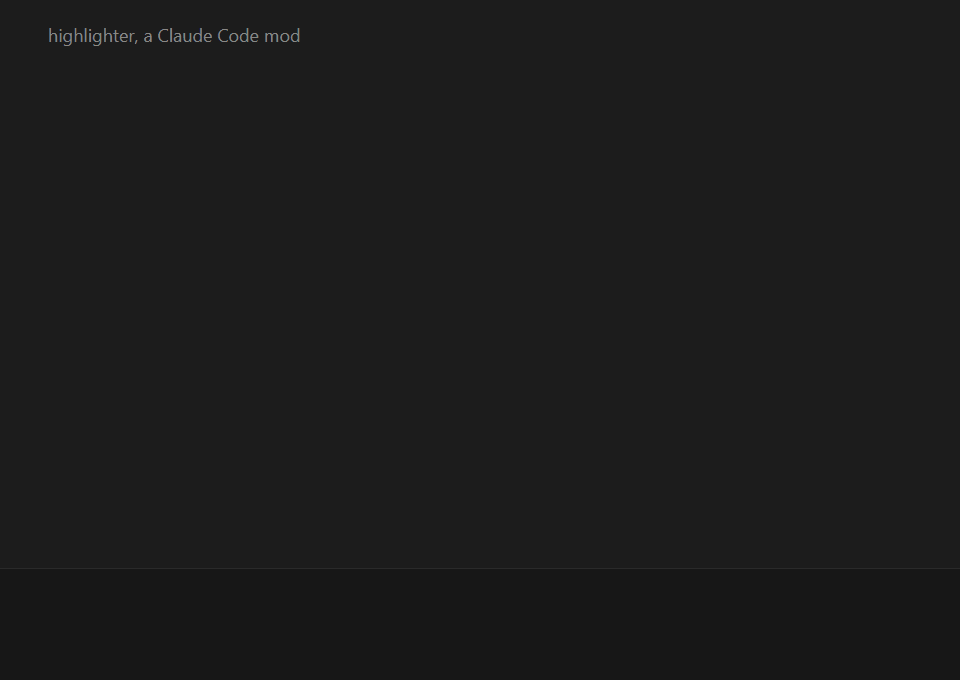
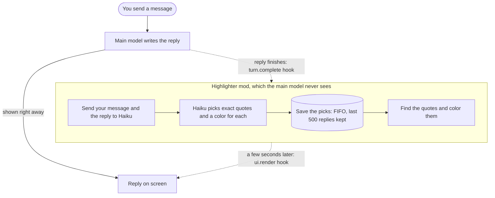

# highlighter

A Claude Code mod that colors the parts of Claude's replies you should read first.

After each reply, Claude Haiku picks a few exact quotes and the mod paints them:

| Color | Light | Dark | Meaning |
| --- | --- | --- | --- |
| Yellow highlight | `#FFE066` | `#FFE066` | Claude is waiting on you |
| Blue text | `#0066CC` | `#4A9BE8` | The key result |
| Red text | `#C8501B` | `#E57F58` | A warning |
| Green text | `#12A05E` | `#3DBF7E` | Done and verified |

Color codes such as `#0066CC` or `rgb(0, 102, 204)` are drawn on their own color.

The main model is never told about highlights.



## Install

In a terminal session of Claude Code:

```
/plugin install highlighter --marketplace ParkerCai/highlighter
```

Pick the user scope so it also runs in the desktop app.

## Use

- Highlights appear a few seconds after a reply finishes.
- `/highlight-preview` shows what each color means.
- `/config` has two settings: the model that picks the quotes (`claude-haiku-5-5` by default) and the color set (`auto`, `light` or `dark`).

## How it works



1. When a reply finishes, the mod sends your message and the reply to Haiku in a separate request.
2. Haiku answers with exact quotes, each tagged `decide`, `key`, `warn` or `done`.
3. The mod finds each quote in the reply and draws those lines in color. Other lines stay as they are.
4. Picks are saved in the mod's store, the last 500 replies, so a reopened chat keeps its colors.

### Storage

The store is a FIFO queue, 500 replies deep: each new reply's picks go in at the end, and once there are more than 500, the oldest are deleted. The mod reads the store once when it loads and keeps the picks in memory, because a surface that is kept waiting while a reply is drawn shows its own version of the reply and never comes back for a late answer. The cap is there because Claude Code limits a mod's store to 4 MiB and rewrites the whole file on each save. 500 replies stay under the cap even if every reply had the most picks possible (12 quotes of up to 600 characters each), and take under 200 KB as replies usually run.

Eviction is by age, not by chat. The mod does not record which chat a reply belongs to, so it cannot drop an archived chat's replies as such. It does not need to: archived chats are the old ones, so their replies are the ones that age out. Tracking chats would add code for the same result.

The request goes through the session's own login, the same one the main model uses. No separate API key is needed.

## Model

The `model` setting picks the model, `claude-haiku-5-5` by default. Change it with `/config` in a terminal session when a newer Haiku comes out.

Set it to `haiku` to follow Claude Code's own name for its current Haiku. That name moves to a new Haiku on Claude Code's schedule, which can trail a release, so it is not the default.

If the chosen model is retired or not offered, the mod switches to `haiku` by itself and says so once.

## Cost

A typical reply is about 1,500 input tokens for Haiku, plus a few hundred tokens of thinking and answer: well under a tenth of a cent, or about 5 cents per 100 replies at Haiku 5.5 API prices. On a subscription it counts toward plan usage instead. Replies under 80 characters are skipped.

## Limits

- Only the final reply of a turn is read.
- Code blocks and tables are never highlighted.
- If the Haiku call fails, the reply stays plain.

## Files

- `hooks/register.tsx`: the hooks: reading each reply, drawing, and the preview command
- `hooks/select.ts`: the prompt Haiku gets, and how its answer is read
- `hooks/marks.ts`: finds the quotes and color codes in a reply and splits it into painted lines
- `hooks/preview.ts`: the sample reply `/highlight-preview` draws
- `tests/highlighter.test.tsx`: the tests

## Develop

```
claude plugin test .
claude plugin validate .
claude --plugin-dir .
```

The demo GIF is rendered from `demo/demo.html`: in `demo/`, run `bun install` then `node frames.mjs` (needs ffmpeg).
